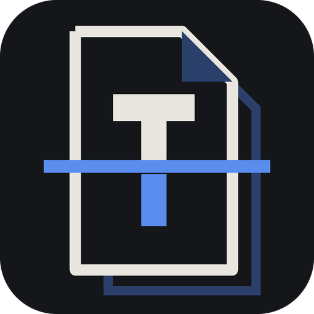
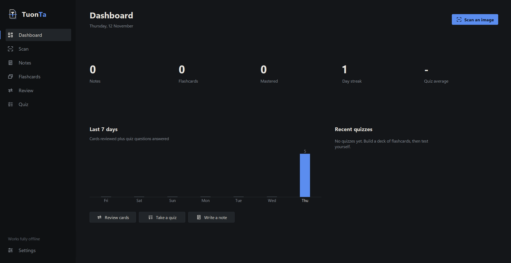
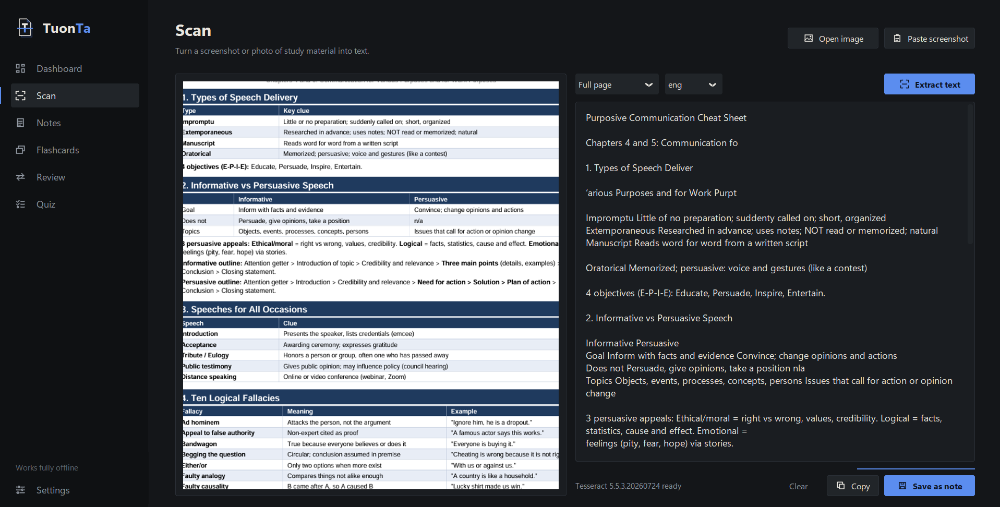
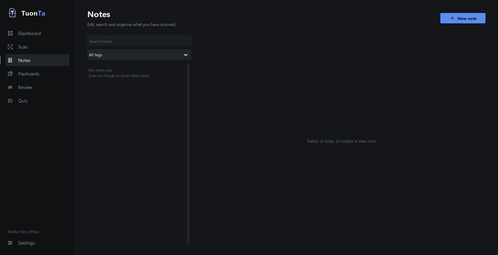
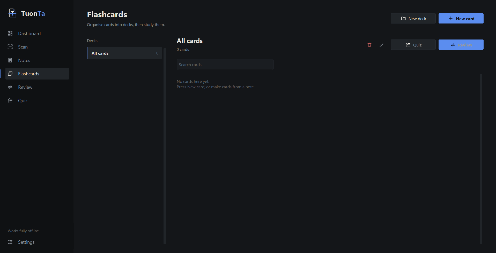
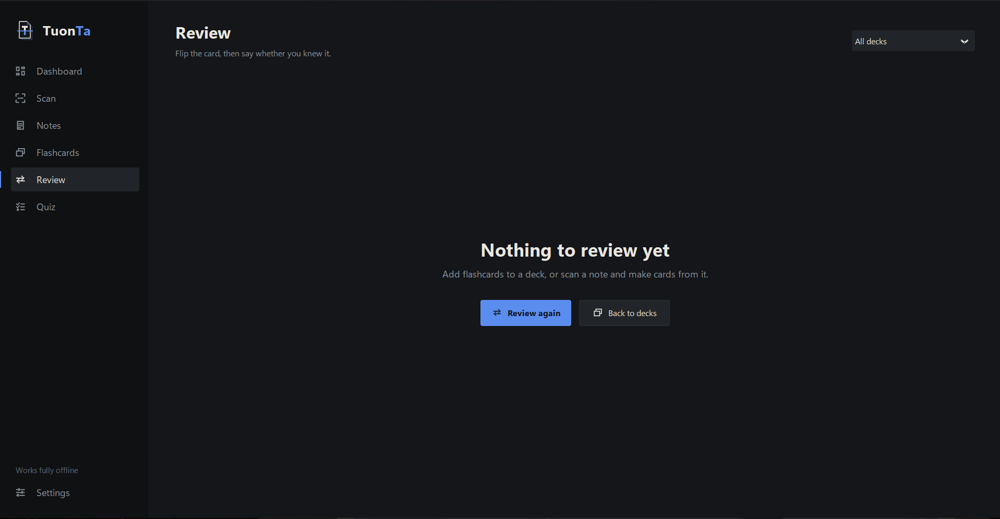
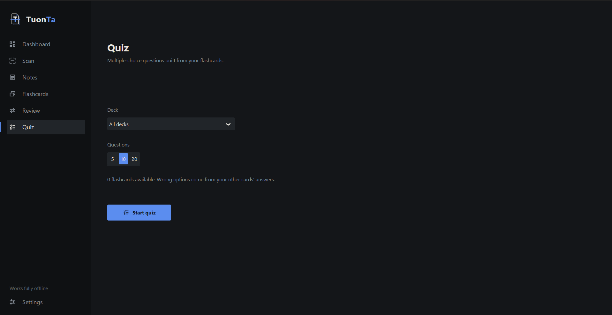

<p align="center">
  
</p>

<h1 align="center">TuonTa</h1>

<p align="center">
  Turn screenshots of study material into editable notes and flashcards.<br>
  Offline, private, and free of AI services.
</p>

> *Tuon* means "to study" in Cebuano. *Ta* is "us". TuonTa is "let's study".

## The logo

A page with a folded corner, a **T**, and a blue scan beam. Above the beam the letter is still paper;
below it, the letter has been captured and turns blue. The ghost page behind it is the flashcard it
becomes. The same folded corner appears on every flashcard in the app. The logo is drawn in code
(`TuonTa/ui/drawing.py`) and also ships as `assets/logo.svg`, `assets/logo.png` and `assets/icon.ico`.

## Screenshots

| | |
|---|---|
|  <br> *Dashboard* |  <br> *Scan (OCR workspace)* |
|  <br> *Notes editor* |  <br> *Flashcard decks* |
|  <br> *Review with flip animation* |  <br> *Quiz mode* |


## Features

- **Import** PNG, JPG and JPEG files, or paste a screenshot straight from the clipboard (Ctrl+V).
- **Offline OCR** with Tesseract. Images are cleaned up first (grayscale, upscaling, contrast, dark-theme inversion).
- **Notes**: edit, tag, search, export to .txt, with unsaved-change protection and Ctrl+S.
- **Flashcards**: decks, manual cards, and rule-based card detection from `Term: definition`, `Term - definition`, `Q:` / `A:` and question-then-answer lines.
- **Review** with a flip animation and Leitner boxes: cards you miss return to box 1 and come up sooner.
- **Quiz** with multiple-choice questions built from your own cards (wrong options are other cards' answers).
- **Progress**: day streak, mastered cards, quiz average, 7-day activity chart, quiz history.
- **Data**: everything in SQLite; full JSON export and import (validated, duplicate-safe).

Not included on purpose: AI APIs, chatbots, generated content, accounts or network calls.

## Installation

1. Install **Python 3.11+** (with Tk, included in the python.org installers).
2. Install **Tesseract OCR**:
   - Windows: installer from <https://github.com/UB-Mannheim/tesseract/wiki>
   - macOS: `brew install tesseract`
   - Linux: `sudo apt install tesseract-ocr` (and `python3-tk`)
3. Install the Python packages and run:

```bash
python -m venv .venv
# Windows: .venv\Scripts\activate      macOS/Linux: source .venv/bin/activate
pip install -r requirements.txt
python main.py
```

If TuonTa can't find Tesseract, open **Settings** and point it at the executable.
Extra OCR languages are picked up automatically from your Tesseract install.

## Usage

1. **Scan**: open an image or paste a screenshot, fix any OCR mistakes, then *Save as note*.
2. **Notes**: tidy the text. Press *Make flashcards* to turn detected definitions into cards, or highlight text first to build one card by hand.
3. **Review**: flip cards (Space), then mark *Got it* (right arrow) or *Still learning* (left arrow).
4. **Quiz**: pick a deck and length, answer with the mouse or keys 1 to 4.

| Shortcut | Action |
|---|---|
| Ctrl+1 to Ctrl+6 | Jump between pages |
| Ctrl+V (Scan) | Paste screenshot |
| Ctrl+S (Notes) | Save note |
| Space / Left / Right (Review) | Flip / still learning / got it |
| 1 to 4, Enter (Quiz) | Choose answer / next question |

## Project structure

```
TuonTa/
├── main.py                  entry point
├── assets/                  logo.svg, logo.png, icon.ico
├── docs/screenshots/        GitHub README screenshots
├── scripts/make_assets.py   regenerates the PNG and ICO
├── tests/test_core.py       unit tests for the non-UI logic
└── TuonTa/
    ├── config.py            paths and constants
    ├── core/                no UI imports in here
    │   ├── database.py      SQLite schema and queries
    │   ├── ocr.py           Tesseract wrapper and image pre-processing
    │   ├── parser.py        rule-based card detection
    │   ├── quiz.py          multiple-choice generation
    │   ├── transfer.py      JSON export and import
    │   └── settings.py      JSON settings
    └── ui/
        ├── app.py, sidebar.py, theme.py, icons.py, drawing.py
        ├── components.py, dialogs.py, flipcard.py
        └── pages/           dashboard, scan, notes, flashcards, review, quiz, settings
```

Your data lives in `~/.tuonta/` (set `TUONTA_HOME` to change it).

## Tests

```bash
python -m unittest discover tests
```

## Tech

Python 3.11+, CustomTkinter, Pillow, Pytesseract, SQLite. Released under the MIT License.
